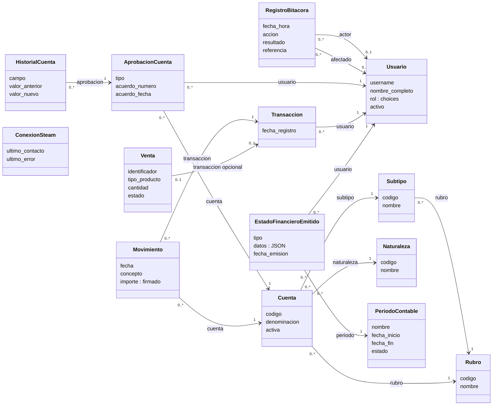
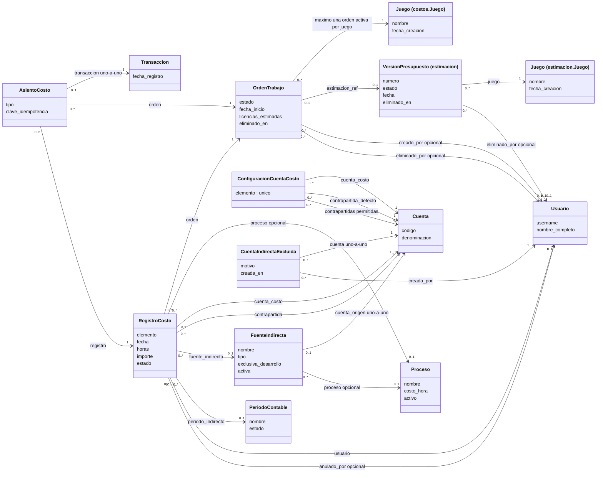
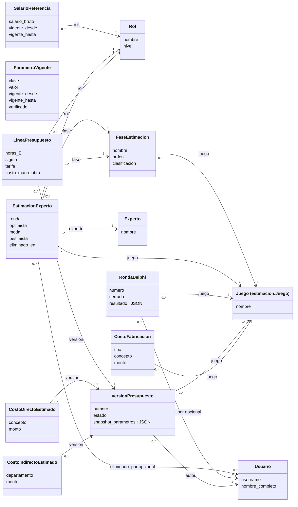

# Clases principales y relaciones del sistema

Este documento resume las entidades persistidas definidas en los `models.py` de Django y sus relaciones declaradas mediante `ForeignKey`, `OneToOneField` y `ManyToManyField`. Sirve como base para dibujar o actualizar el diagrama de clases del sistema.

Los diagramas muestran relaciones del modelo de datos; no agregan dependencias que solo existan en servicios o vistas. Los extremos indican multiplicidad. Las flechas van desde el modelo que declara la referencia hacia el modelo referenciado.

## 1. Identidad, catálogo, mayor, ventas y estados financieros

## 2. Costos y vínculo con la estimación

## 3. Estimación de presupuesto

## Relaciones importantes para interpretar

- **Orden y estimación:** `OrdenTrabajo.estimacion_ref` es una clave foránea nullable a `estimacion.VersionPresupuesto`. La restricción única para órdenes activas hace que cada versión se relacione con cero o una orden activa; una orden puede no tener versión o tener una. Archivar una orden libera esa versión para otra orden. La relación no está limitada a versiones con un estado específico por la definición del campo.
- **Dos modelos `Juego`:** `costos.Juego` y `estimacion.Juego` son clases y tablas diferentes. La orden apunta a `costos.Juego`; la versión del presupuesto apunta a `estimacion.Juego`. El modelo no declara una clave foránea entre ambos juegos ni comprueba que sus nombres coincidan. La conexión entre costeo y estimación ocurre a través de `OrdenTrabajo.estimacion_ref`.
- **Usuario y rol:** `usuarios.Usuario.rol` es un campo de texto con opciones, no una relación a otra tabla. `estimacion.Rol` sí es un modelo persistido y representa puestos/niveles usados para estimar.
- **Configuración de cuentas:** `ConfiguracionCuentaCosto` contiene dos claves foráneas a `catalogo.Cuenta` y una relación muchos-a-muchos adicional para las contrapartidas permitidas.
- **Costos indirectos automáticos:** `RegistroCosto.fuente_indirecta` y `periodo_indirecto` son opcionales individualmente en la base, pero la restricción del modelo exige que ambos estén presentes juntos y que el elemento sea indirecto.
- **Periodo del movimiento:** `libro_mayor.Movimiento` no tiene clave foránea a `PeriodoContable`; el período se determina por la fecha del movimiento. En cambio, los estados financieros emitidos sí guardan una relación directa con el período.
- **Relaciones opcionales:** en el diagrama, `0..1` corresponde a claves foráneas `null=True` o a un lado único opcional. Las relaciones uno-a-uno inversas pueden no tener objeto relacionado todavía.
- **Baja lógica:** `OrdenTrabajo`, `EstimacionExperto` y `VersionPresupuesto` guardan `eliminado_en` y `eliminado_por`; archivar no borra el registro ni sus vínculos. El par de campos debe estar completo o vacío. Se puede conservar más de una orden histórica por juego, con un máximo de una activa.
- **Versiones inmutables:** las versiones aprobadas, vigentes o rechazadas no permiten editar sus datos de presupuesto. La baja/restauración solo cambia los metadatos de archivo; las correcciones de presupuesto se representan con una versión nueva.
- **Choices no son clases/tablas:** estados, tipos, elementos, acciones y roles de usuario definidos con `TextChoices` o listas de opciones se guardan como campos del modelo; no se muestran como entidades relacionadas.

## Modelos fuente

- [Usuarios](../usuarios/models.py)
- [Bitácora](../bitacora/models.py)
- [Catálogo de cuentas](../catalogo/models.py)
- [Libro Mayor](../libro_mayor/models.py)
- [Estados financieros](../estados_financieros/models.py)
- [Ventas](../ventas/models.py)
- [Costos](../costos/models.py)
- [Estimación](../estimacion/models.py)
